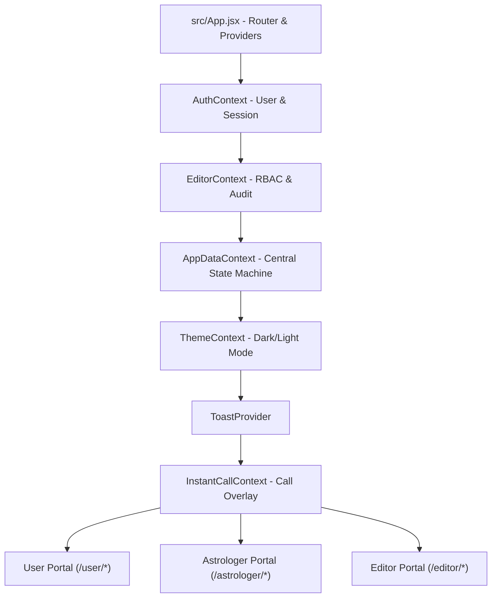
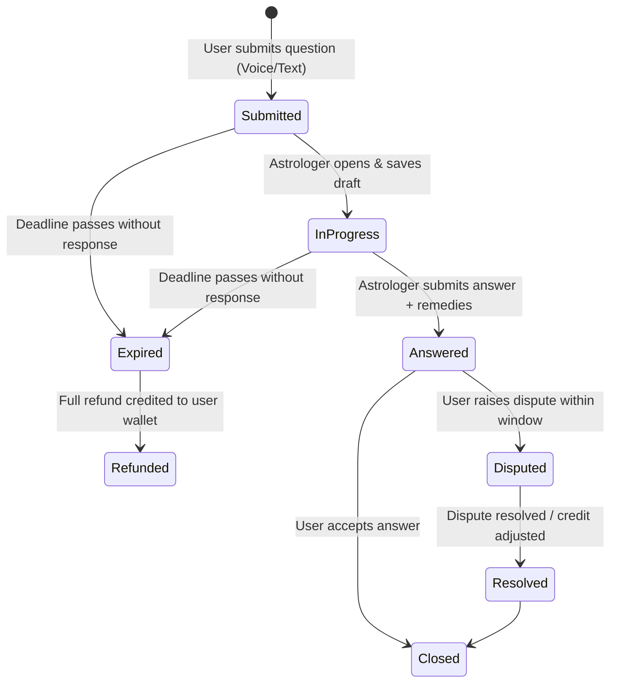

# Astro Connect (`textbased-demo`) — Comprehensive Project Analysis & Architecture Guide

> **Project Name:** Astro Connect (Workspace: `sabrefish` / `textbased-demo`)  
> **Type:** Single-Page Web Application (SPA)  
> **Core Domain:** Astrology Consultation, Remedies (Pariharam/Atonement), Live Sessions, & Creator Portal  
> **Tech Stack:** React 19 · Vite 8 · React Router DOM v7 · Tailwind CSS 4 · Framer Motion · Lucide React · Vitest · Oxlint  

---

## 1. Executive Summary

**Astro Connect** is a feature-complete, enterprise-grade astrology consultation portal built as a client-side Single-Page Application (SPA) in **React 19** and **Vite**. The application provides an end-to-end platform bridging seekers (Users) and astrological consultants (Astrologers), complemented by a dedicated delegated management portal (Editors/Assistants).

The platform features an in-memory and `localStorage`-backed state architecture that simulates real-world backend services, including:
- **Text-Based Consultations:** Timed Q&A with audio recording, document attachments, remedy prescribing, and dispute resolution.
- **Real-Time Communication:** Instant calling, live chat sessions, and multi-user live streaming broadcasts.
- **Atonement / Pariharam Engine:** Multi-day spiritual remedy workflows with daily task logging and photo proof verification.
- **Appointment & Calendar Scheduling:** Slot generation, working hour constraints, blackout dates, and booking drawers.
- **Financial & Wallet Ecosystem:** Multi-tier pricing, package purchases, promotional campaigns, earnings ledgers, commission splits, payout settlements, and autopay.
- **Role-Based Access Control (RBAC):** Three distinct portals (User, Astrologer, Editor) with granular permission trees and audit logging.

---

## 2. Architecture & Technology Stack



### Technology Breakdown

| Component | Library / Tool | Purpose & Implementation |
| :--- | :--- | :--- |
| **Runtime & Core** | React 19 (`react`, `react-dom`) | Functional components, modern hooks (`useMemo`, `useCallback`, `useContext`, `useRef`). |
| **Bundler & Tooling** | Vite 8 + `@vitejs/plugin-react` | Ultra-fast HMR and build compilation powered by Oxc. |
| **Routing** | React Router DOM v7 | Nested routes, layout shells, role guards, and deep-link redirects. |
| **Styling** | Tailwind CSS 4 + Modular CSS | Utility classes combined with role-specific stylesheets in `src/css/`. |
| **Animations & UI** | Framer Motion | Smooth transitions, modal overlays, sliding drawers, and animated counters. |
| **Icons** | Lucide React + Custom SVGs | Interface iconography, custom Vedic astrology symbols, and temple glyphs. |
| **Reporting / Export** | jsPDF + jspdf-autotable | Client-side generation of consultation summaries and remedy charts. |
| **Code Quality & Tests** | Oxlint & Vitest | High-speed linting and unit testing for domain business logic. |

---

## 3. Portals & Feature Modules

### 3.1 Seeker / User Portal (`/user/*`)

The User Portal provides an intuitive interface for seekers looking for astrological guidance and spiritual remedies:

1. **Dashboard (`/user`)**:
   - Quick balance indicators, wallet shortcuts, ongoing consultations, and upcoming appointments.
   - Recommended astrologers and recent remedies progress widget.

2. **Question Dashboard (`/user/ask-question/*`)**:
   - **Ask New Question**: Choose between General or In-depth Personal questions; category selection (Marriage, Career, Health, Finances); voice input with Speech-to-Text capability (`VoiceTextArea.jsx`); attachment uploads.
   - **My Questions (`/my-questions`)**: Active question tracker with countdowns towards astrologer answer deadlines.
   - **Purchased Packages (`/purchased`)**: View remaining question credits from prepaid bundles.
   - **Question History (`/history`)**: Chronological archive of past questions, answers, and downloadable PDF reports.
   - **Dispute Resolution (`/disputes`, `/user/raise-dispute`)**: Raise and track disputes for answers that were delayed, inadequate, or off-topic.

3. **Astrologer Discovery & Booking**:
   - Astrologer directory (`/user/astrologers`, `/user/chat-astrologers`, `/user/call-astrologers`).
   - Comprehensive Profile (`/user/astrologer/:id`) showcasing experience, specialties, languages, pricing, client reviews (`/reviews`), and badges.
   - Appointment Booking (`/user/appointments/book/:id`): Real-time calendar slot selector with date/time pickers.

4. **Live Communications & Consultations**:
   - **Instant Audio Call (`/user/call/:id`)**: WebRTC-style in-call UI with duration counters, mute, speaker, and floating drawer minimizing.
   - **Instant Chat (`/user/instantchat/:id`)**: Messaging interface with automated birth-detail step collection (`ChatBirthDetailsStep.jsx`).
   - **Live Video Sessions (`/user/live-session`)**: Attend broadcast rooms, send comments, send virtual gifts, and ask priority questions.

5. **Atonement / Pariharam Hub (`/user/atonements`)**:
   - Multi-day remedy tracker for astrological mitigations (e.g., Navagraha pujas, 21-day mantra recitations, charity feeds).
   - Daily checklist with photo/proof upload (`setAtonementDayProof`) and astrologer verification status.

6. **Horoscope & Kundli Details (`/user/horoscope`)**:
   - Input birth data (date, exact time, geographic location, coordinates).
   - Rasi, Nakshatra, Lagna calculations, planetary positions, and divisional chart views.

7. **Financial Management (`/user/wallet/*`)**:
   - Wallet overview, transaction ledger, instant top-ups, refund logs, saved payment methods (`AddPaymentMethod.jsx`), and autopay configuration.

---

### 3.2 Astrologer Portal (`/astrologer/*`)

Designed as a business management and client-service suite for verified astrologers:

1. **Astrologer Dashboard (`/astrologer`)**:
   - Metrics: Pending questions, today's schedule, unread notifications, live session countdown, monthly revenue.

2. **Question Answering System (`/astrologer/answer-question`)**:
   - Structured answering workbench featuring:
     - Question context, user birth chart, and question attachments.
     - Auto-saving answer drafts (`applyQuestionDraft`).
     - Voice-to-text recording support.
     - Attachment uploader (chart images, recorded voice notes, supplementary guides).
     - Integrated remedy/atonement assignment picker (`SavedAtonementPicker.jsx`).
     - Deadline compliance timers (with automated refund penalties if deadline expires).

3. **Campaigns & Sales Management (`/astrologer/sales-management`)**:
   - Set standard pricing for General and Personal questions.
   - Set monthly capacity quotas (`MONTHLY_QUESTION_CAPACITY`).
   - Create flash sales and discount campaigns by category (Marriage, Career, Health) with compulsory question threshold controls.

4. **Appointment & Availability Management (`/astrologer/appointments/*`)**:
   - Weekly availability schedule configuration (day-wise working windows and slot durations).
   - Calendar view (`AppointmentCalendar.jsx`) showing booked, completed, and blocked slots.
   - Holiday / leave calendar to automatically black out consultation times.

5. **Live Broadcasting Room (`/astrologer/live-session/*`)**:
   - Multi-stage setup: Setup & Topic Configuration $\rightarrow$ Device Check $\rightarrow$ Live Room $\rightarrow$ Session Analytics Summary.
   - Interactive live room with audience list, live chat moderation, super-chats, and pinned questions.

6. **Perks, Subscriptions & Audience (`/astrologer/perks-benefits/*`, `/astrologer/audience/*`)**:
   - Tiered subscriber program (e.g., Silver, Gold, Platinum).
   - Exclusive perks definition (free monthly questions, priority call queues, discounted poojas).
   - Audience management with communication logs and block/restrict capabilities.

7. **Earnings, Wallet & Settlements (`/astrologer/wallet/*`)**:
   - Revenue breakdown by source (Text Questions, Calls, Chats, Appointments, Live Tips, Subscriptions).
   - Running ledger calculations, platform fee deductions, payout settlements, withdrawal requests, and bank/UPI accounts.

8. **Delegation & Assistant Management (`/astrologer/account/editors-assistants`)**:
   - Invite assistants/editors via secure link or email.
   - Configure granular module-level permissions and inspect audit trails.

---

### 3.3 Editor & Assistant Portal (`/editor/*`)

A delegated administrative console allowing assistants and sub-editors to manage day-to-day operations on behalf of an astrologer without having full account access:

- **RBAC Security Guard (`RequireEditorPermission`)**: Restricts access based on astrologer-granted permission keys.
- **Permission Matrix**:
  - `Availability` (View / Manage)
  - `Campaigns` (View / Manage)
  - `Profile` (View / Edit)
  - `Questions` (View / Respond / Draft)
  - `Appointments` (View / Reschedule)
  - `Live Events` (View / Schedule)
  - `Perks & Discounts` (View / Configure)
  - `Atonements` (Track Progress / Verify Proof)
  - `Notifications` (View / Send)
- **Draft & Approval Pipeline**: Assistants can prepare answer drafts and remedy recommendations for the astrologer's final review.
- **Audit Logging**: Every action taken by an editor is tracked with timestamps and user IDs.

---

## 4. State Management & Data Architecture

```mermaid
flowchart LR
    subgraph Storage ["Browser Persistence"]
        LS_Auth[localStorage: astroconnect-auth-session]
        LS_Users[localStorage: astroconnect-auth-users]
        LS_Editor[localStorage: astroconnect-editor-*]
        LS_Theme[localStorage: astroconnect-theme]
    end

    subgraph StateProviders ["React Context Hierarchy"]
        Auth[AuthContext]
        Editor[EditorContext]
        AppData[AppDataContext (~5,000 LOC)]
        Call[InstantCallContext]
    end

    subgraph DomainEntities ["In-Memory Data Models"]
        Questions[Questions & Drafts]
        Appointments[Appointments & Availability]
        Atonements[Atonements & Day Proofs]
        Wallet[Ledgers, Balances & Payouts]
        LiveSessions[Live Broadcast Rooms]
        Audience[Followers & Subscribers]
    end

    LS_Auth <--> Auth
    LS_Editor <--> Editor
    Auth --> AppData
    Editor --> AppData
    AppData --> DomainEntities
```

### Key Context Providers

1. **`AuthContext.jsx`**:
   - Manages authentication state, user profiles, session tokens, and role switching.
   - Seeds default test accounts (`user@astroconnect.com`, `astro@astroconnect.com`, `dr.rani@astroconnect.com`).
   - Normalizes email formats and derives username handles.

2. **`AppDataContext.jsx`**:
   - Central business engine of the app (~5,000 lines of functional logic).
   - Manages stateful collections for questions, campaigns, consultations, appointments, remedies, and notifications.
   - Implements automated timers for live session expiration (`LIVE_SESSION_MAX_DURATION_MS`) and question answer deadlines (`ANSWER_DEADLINE_EXCEEDED_REASON`).

3. **`EditorContext.jsx`**:
   - Manages invitations, editor roster, permission sets, session validity, drafts, and audit events.

4. **`InstantCallContext.jsx`**:
   - Controls real-time audio consultation modals, active timers, microphone mute, speaker toggle, and minimized call bubbles.

5. **`ThemeContext.jsx`**:
   - Toggles light and dark themes by managing the `dark` class on `document.documentElement` with local storage synchronization.

---

## 5. Domain Models & Business Logic

### Text Questions Lifecycle


### Atonement / Pariharam Lifecycle
- **Definition**: Spiritual remedy structured over a timeline (e.g. 7, 21, 48, or 108 days).
- **Daily Flow**: Each day displays instructions, mantras, temple visit requirements, and donation suggestions.
- **Proof of Completion**: User uploads a daily photo or confirmation text.
- **Review**: Astrologer or authorized Editor reviews the submission and marks the day as `verified`.
- **Milestone Completion**: System calculates completion percentage and generates an auspicious certificate upon final day completion.

### Dynamic Appointment & Slot Generation
- Configured in `src/utils/appointments.js`.
- Generates slots dynamically based on starting hours, ending hours, slot intervals (e.g. 15, 30, 45 mins), break periods, existing bookings, and gazetted/custom holidays (`src/data/holidays.js`).

---

## 6. Directory Structure

```
sabrefish/
├── ATONEMENT-SCRUM.md         # Comprehensive Scrum backlog and user stories
├── context.md                 # High-level developer context
├── IDEA.md                    # Project origin memo
├── package.json               # Dependencies and build scripts
├── vite.config.js             # Vite 8 config with Tailwind v4 & React plugins
├── public/                    # Static assets
└── src/
    ├── App.jsx                # Root router, role guards, provider nesting
    ├── main.jsx               # Application entry point
    ├── index.css              # Global styles & Tailwind CSS imports
    ├── components/            # Reusable UI components
    │   ├── Layout.jsx         # App shell (nav, header, notifications, profile popovers)
    │   ├── NotificationsPanel.jsx
    │   ├── VoiceTextArea.jsx  # Speech-to-text recording interface
    │   ├── atonements/        # Remedy cards, day flows, custom icons
    │   ├── campaigns/         # Campaign cards and discount controls
    │   ├── ui/                # StatCard, PageHeader, Card, ActionCard primitives
    │   └── user/              # User-specific modals, consultation drawers, badges
    ├── pages/                 # Route views organized by domain and role
    │   ├── AskQuestion.jsx    # Question submission wizard
    │   ├── AnswerQuestion.jsx # Astrologer answering workbench
    │   ├── Atonement.jsx      # Astrologer remedy management
    │   ├── astrologer/        # Astrologer-specific subpages (Live, Consultation, Schedule)
    │   ├── editor/            # Editor portal subpages & permission guards
    │   └── user/              # User-specific subpages (Dashboard, Wallet, Live, Pooja)
    ├── state/                 # React Context providers (Auth, AppData, Editor, Call, Theme)
    ├── utils/                 # Business logic algorithms, calculation engines, and unit tests
    │   ├── answer.js          # Deadlines, draft state, submissions
    │   ├── appointments.js    # Slot generator, calendar math, overlaps
    │   ├── atonements.js      # Remedy lifecycle, day proof handlers
    │   ├── editorAccess.js    # Granular permission engine
    │   ├── horoscope.js       # Vedic astrology calculations (Rasi, Nakshatra)
    │   ├── liveSessions.js    # Live room duration & expiration math
    │   ├── questions.js       # Quotas, capacity validation, campaign discounts
    │   ├── roleRoutes.js      # Role definitions and route helpers
    │   └── wallet.js          # Running balances, payout settlement rules
    └── data/                  # Realistic mock datasets (Astrologers, consultations, notes)
```

---

## 7. Testing & Quality Assurance

The project includes unit test suites located alongside the utility modules in `src/utils/` and `src/data/`:

- `appointments.test.js` & `appointmentHistoryData.test.js`: Slot interval validation, overlap prevention, timezone offsets.
- `answer.test.js`: Deadline calculation, draft merging, refund triggers.
- `atonements.test.js` & `atonementTemplates.test.js`: Multi-day progression, status transitions, proof verification.
- `editorAccess.test.js`: Permission boundary checks and role enforcement.
- `questions.test.js` & `questionLifecycle.test.js`: Monthly quota calculations, campaign discount math, credit debiting.
- `wallet.test.js` & `userWallet.test.js`: Running ledger arithmetic, deposit/withdrawal validation, payout fees.
- `horoscope.test.js`: Astrological formula validation.

---

## 8. Development & Build Setup

### Prerequisites
- Node.js 18+ or 20+
- npm or pnpm

### Scripts
```bash
# Install dependencies
npm install

# Start Vite development server with HMR
npm run dev

# Run Oxlint fast linter
npm run lint

# Execute Vitest test suite
npm run test

# Build for production
npm run build

# Preview production build locally
npm run preview
```

### Pre-Configured Demo Credentials

| Role | Email | Password | Default Redirect |
| :--- | :--- | :--- | :--- |
| **Seeker (User)** | `user@astroconnect.com` | `User@123` | `/user` |
| **Astrologer** | `astro@astroconnect.com` | `Astro@123` | `/astrologer` |
| **Astrologer (Alias)** | `dr.rani@astroconnect.com` | `Astro@123` | `/astrologer` |
| **Editor / Assistant** | `priya@astroconnect.com` | *(Invitation link)* | `/editor` |

---

## 9. Key Strengths & Production Roadmap

### Strengths
1. **Realistic Domain Simulation**: Rich domain modeling including Vedic astrology terminology (Rasi, Nakshatra, Lagna, Pariharam/Atonement).
2. **Zero-Backend Standalone Capability**: Fully demoable in any static hosting environment (e.g. Vercel, Netlify, GitHub Pages) without configuring external databases.
3. **Enterprise RBAC**: Clear separation of concern between Astrologer and Assistant roles with granular permission toggles and audit logging.
4. **Rich Interactive UX**: Integrated speech recording, PDF report generation, live call drawer widgets, and animated transitions.

### Recommended Next Steps for Production
1. **Backend Integration**: Replace Context-level state machines with REST/GraphQL APIs (e.g., Node.js/NestJS, FastAPI, or Supabase).
2. **Real-Time Infrastructure**: Connect instant calls and live streams to WebRTC/Agora/LiveKit infrastructure and WebSocket servers for live chat.
3. **Payment Gateway**: Integrate Razorpay, Stripe, or UPI payment gateways to replace simulated wallet top-ups and autopay.
4. **TypeScript Migration**: Migrate codebase incrementally using `.d.ts` or convert to `.tsx` for end-to-end type safety.
